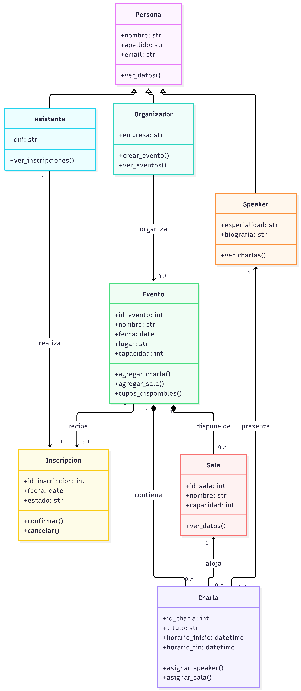

# EventManager – Sistema de Gestión de Eventos

## Descripción del proyecto

EventManager es una aplicación desarrollada en Python utilizando el paradigma de Programación Orientada a Objetos (POO).

El sistema tiene como objetivo facilitar la administración de múltiples eventos independientes, permitiendo gestionar organizadores, expositores (speakers), asistentes, charlas, salas e inscripciones.

Este proyecto se desarrolla como trabajo práctico integrador de la materia Programación Orientada a Objetos.

## Objetivo general

Diseñar e implementar una aplicación interactiva que permita gestionar eventos mediante la utilización de clases, objetos, atributos, métodos y relaciones.

## Funcionalidades previstas

- Crear y administrar eventos.
- Registrar organizadores.
- Registrar speakers y asignarlos a charlas.
- Registrar asistentes.
- Administrar salas y sus capacidades.
- Programar charlas.
- Gestionar inscripciones a eventos.
- Consultar los cupos disponibles.

## Clases del sistema

El diseño inicial contempla las siguientes clases:

1. Persona
2. Organizador
3. Speaker
4. Asistente
5. Evento
6. Charla
7. Sala
8. Inscripcion

## Tecnologías

- Lenguaje: Python.
- Paradigma: Programación Orientada a Objetos.
- Herramienta de modelado: Mermaid.
- Entorno de desarrollo: Visual Studio Code.

## Etapas del proyecto

1. Diseño del diagrama de clases UML.
2. Implementación inicial de clases y objetos.
3. Creación de objetos con datos predefinidos.
4. Desarrollo de una aplicación interactiva.
5. Implementación de arquitectura N-Capas.
6. Incorporación de persistencia de datos.
7. Pruebas y puesta en funcionamiento.

## Estado actual

**En desarrollo – Etapa inicial.**

Se encuentra implementada la primera versión de las clases `Persona` y `Speaker`, incluyendo una relación de herencia y una prueba de instanciación de objetos.

## Ejecución

Para ejecutar la versión inicial, abrir una terminal en la carpeta principal del proyecto y ejecutar:

```bash
python main.py
```

## Diagrama de clases UML

El siguiente diagrama representa las clases principales
del sistema EventManager, sus atributos, métodos
y relaciones.



### Código fuente del diagrama

El código Mermaid utilizado para generar el diagrama
se encuentra en:

[Ver código Mermaid](diagramas/diagrama_clases.mmd)


## Autoría

Proyecto académico desarrollado para la materia Programación Orientada a Objetos.
